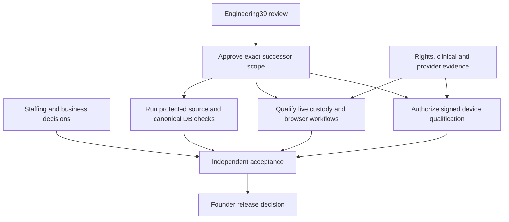

# Engineering39 release readiness

Release is **NO_GO**. All 38 requirements and 18 gates remain formally **UNACCEPTED**. M1-03 awaits original external custody and M2-01 remains unauthorized. J01 Visible Pores is the sole Korean assessment. Positive admission remains closed.

## Completed engineering

- The continuation adds exact original recorded use, verified retractions and field-scoped bottle observations to the existing professional pre-visit review/export. The archive verifies the associated applied routine and denies use or formula projections when a required receipt is missing. The default professional API remains closed.
- A separate synthetic checkpoint database now witnesses custody-head changes. It confirms exact durable successors after process termination and refuses a stale encrypted snapshot or an unresolved pending transition. The professional repository requires an independent freshness source for these receipts and revalidates it before publishing a review or export. The SQLite witness and the professional API test use separate fixtures. Neither installs a production adapter.

- `ffefa1ca8` exercises actual process termination on either side of a durable SQLite commit with the real encrypted custody envelope and archive codec. It verifies exact append replay, concurrent successors, tombstone persistence, restartable erasure rechecks and rollback when a returned envelope fails authentication. The test-only host uses one SQLite writer transaction, full synchronous commit and a fixed synthetic key. It has no production binding.
- `3ae0ccb86` reads exact committed mobile apply and clear outcomes under the current professional pre-visit grant. The available source is field-limited and bound to the exact archive membership and original hashes. The integration executes load, review and export through the existing API and refuses a stale source, wrong receipt, extra field, final grant loss and tombstoned epoch. Zero default professional admission remains in force.
- The Deno `check` invocation uses the supported command and retains the frozen lock. The JSR manifest fetch failed. `inherited-edge-entrypoint-supported.log` records the failure at the pinned dependency, and the candidate's Edge implementation and lock are byte-identical to the checked starting checkpoint.
- The candidate and the exact Engineering38 and PR48 patch trees are authenticated in `PATCH_VERIFICATION.json`. The review preserves original release, G97 and native checkers and their checked inputs. `SUCCESSOR_SOURCE_CANDIDATE.json` provides the source for independent review.

## Critical path

Local engineering and runner preparation can proceed alongside independent source review. An approved runner can qualify executable code while engineering finishes canonical history and operator receipt inspection, and owners can assemble genuine rights, clinical, billing and staffing evidence. The critical join is independent acceptance of the exact candidate and external evidence. None of the three paths alone authorizes release.

## Implementation and qualification checklist

The prerequisite and evidence for each item are listed with its next action in dependency order. The source and project control files are relative to `c16-candidate`. `ALL38_ALL18.md` records the detailed inherited and changed implementation states. “Local $0” means the listed engineering or existing-runner action needs no new paid operation. External costs are unverified unless the action is already known to have zero cost.

| Priority and IDs | Status and exact evidence | Next executable action, prerequisites and success evidence | Authority and cost | Independent work |
|---|---|---|---|---|
| 1 · G97 | Source inventory refutes frozen admission in `final-g97.log` and `SECURITY_INVENTORY_DIAGNOSIS.json` | Original custodian validates each exact added path and disposition against `SUCCESSOR_SOURCE_CANDIDATE.json`, retrieves the original OWASP rules and then runs the preserved static, dependency and secret controls. Success requires raw results and a new independently authorized exact-source acceptance. | Security custodian and Brain. Digest comparison local $0. Rules custody and any approved runner costs unverified. | Yes. Local custody and UI engineering. |
| 1 · DB | Source checks in `final-db-source.log`. Engine missing in `inherited-final-docker-engine-probe.log`. | After Linux-engine preflight, run the two canonical commands in `QUALIFICATION.md`. Capture exact image, migrations, pgTAP, race results, generated types and no schema drift. | Approved local DB runner and original DB custodian. $0 on an existing approved installation with the pinned image. | Yes. Fixtures and owner inputs. |
| 1 · M1-03 | `docs/brain/checkpoints/M1-03/BLOCKED-EXTERNAL-CUSTODY-2026-10-23.md` records original custody blockage. | Original custodian returns already-issued artifacts and independently checks exact bytes, provenance and acceptance controls. Brain resolves original custody. | Original custodian and Brain. Retrieval cost unverified. | Yes. Source work and candidate prep. |
| 1 · M2-01 | `contract.v2.json` and `ALL38_ALL18.md` preserve closed mandate. | A separately issued decision would be required after its original prerequisites. No implementation belongs to Engineering39. | Brain. No new cost under current authorization. | Yes. All authorized scope. |
| 1 · F02, V2-C01 | `ownerRoutineCustody.ts`, `final-custody-restart.log`, `apps/mobile/src/features/photos/photoDeleteJournal.ts` | Qualify an independently operated checkpoint host and bind restore to the tombstone and the verified current head. Add and exercise evidence-based adjudication when the pending operation remains ambiguous. Then exercise withdraw/delete/export on exact signed device and historical backups with adverse key loss and ciphertext return. Evidence must prove scoped erasure and specify media/key retention. | Engineering local $0. Actual storage/key, device and rights custodians required for qualification. External cost unverified. | Yes. Runners, catalog and professional source. |
| 1 · F06, F07, V2-C03, V2-C05 | `actualRoutine.ts`, `routineDecisionRecoveryStore.ts`, `ownerRoutineCustody.ts`, `final-adversarial-mobile.log` | Separate the authenticated unresolved journal from resolved immutable versions and recorded use. Keep versioned read-only migration inputs, prove old/new codec and crash recovery, display exact owner history, and qualify real original-owner ingress. Work in this order before authorized production retirement. | Engineering local $0. Custodian for the independent anchor and durable provider. External cost unverified. | Yes. P03/P04 and browser setup. |
| 1 · V2-C11 | `docs/USER_FLOW_TREE.md`, `inherited-final-browser-loopback-preflight.log` and `BROWSER_OBSERVATION.md` | Restore a working app HTTP and Chromium connection. Replay keyboard, focus, viewport, pending/refused affordances and Back behavior across all three surfaces. Exercise VoiceOver and Dynamic Type on the exact signed build. | Approved browser/device runner. $0 with existing approved resources. | Yes. Device scheduling and source repairs. |
| 1 · P01, P02 | `authority.ts`, `encryptedWorkspaceRepository.ts`, `serverSession.ts` under `apps/professional-web/src` | Qualify provider-backed exact identity, licensed membership, scoped role/MFA, grant activation/revoke/expiry and handoff using a real isolated authority. Record positive and cross-tenant/owner negatives at request and commit time. | Engineering synthetic local $0. Workspace identity, licence and grant custodians authorize actual test authority. Cost unverified. | Yes. P03/P04 with synthetic authority. |
| 2 · P03, P04, P05 | `ownerRoutinePrevisit.ts`, `reconciliationService.ts`, `practiceTemplates.ts`, `previsitApi.ts` and `final-adversarial-professional.log` | Carry the tested original-use and phase linkage into an admitted owner ingress, then connect intended plans, immutable proposal mapping and consumer reconciliation to the real review. Qualify assignment lifetime, read-only recovery, offboarding and retention with approved release identities. Evidence includes exact source, response, withdrawal and original-history restoration. | Engineering local $0. Staff, provider and retention authority required for live qualification. Cost unverified. | Yes. Operator and consumer browser. |
| 2 · F20 | `apps/catalog-operator-console/src/main.ts`, `supabase/functions/catalog-operator/databaseGateway.ts`, `inherited-edge-entrypoint-supported.log` | Build the same-actor/session/control-generation exact receipt read from immutable SQL receipt and audit event, then wire post-claim inspection without reissuing a mutation. Run canonical ACL, expiry, mismatch and same-microsecond cursor cases plus browser support recovery. | Engineering local $0. DB and operator custodians approve routine for canonical runner. External staffing cost unverified. | Yes. Clinical and device. |
| 2 · F03, F04, V2-C02 | `docs/release/full-app-j01/owned-bottle-formula38.md`, `supabase/migrations/20260722000063_catalog_operator_authority.sql` | Keep manual and raw-label intake available, verify exact bottle market/variant and correction. Prepare a reviewed signed source manifest, approved role-based catalog decisions and native OCR adverse tests. Evidence covers source withdrawal and exact old-bottle history. | Engineering local $0. Rights, reviewer and signed-device authority required. External cost unverified. | Yes. Local manual UX and operator source. |
| 2 · F09, V2-C07 | `PhotoDeleteReplay.tsx`, `photoDeleteJournal.ts`, `photoDeleteR3.integration.test.ts` under `apps/mobile/src/features/photos` | Install the exact signed build on already authorized hardware, capture a controlled synthetic diary image, check original recovery, permission/abort, restart, deletion and post-delete artifacts. Inspect device-private logs and residue through approved access. | Device and privacy custodians. $0 on approved existing equipment and account. | Yes. Native command preparation. |
| 2 · F10, F19, V2-C09 | `docs/USER_FLOW_TREE.md`, `docs/E2E_TESTING_CHECKLIST.md` | On signed build exercise permission refusal/acceptance, background/date transitions, actual delivery, widget and Live Activity update/purge, and different owner after restart. Retain exact OS/version/time evidence. | Device and Apple authority. $0 on approved existing equipment and account. | Yes. Device flows can share one run with privacy. |
| 2 · F15, V2-C08 | `docs/USER_FLOW_TREE.md`, `final-adversarial-mobile.log` | Rehearse selected brief text, preview, refusal, exact retry, cancel and genuine recipient handoff, proving the temporary file is removed. Run the scoped professional report and ordinary free flow. | Local tests $0. Rights, privacy and signed-device authority for real recipient behavior. | Yes. Browser synthetic and native shell. |
| 2 · V2-C04, V2-C06 | `docs/release/full-app-j01/today-optional-changes41.md`, `apps/mobile/src/features/today/optionalChange41.ts` | Verify original exception correction and exact factual comparison across source change, deletion and restart. Admit a professional response or catalog-backed formula only after original-grant and catalog-rights evidence. | Engineering local $0. Source authorization and external review costs unverified. | Yes. Local factual paths. |
| 3 · RIGHTS | `docs/release/full-app-j01/owner-packets.md` O08-RIGHTS | Obtain exact licensed assets and J01 input hashes, consent/distribution/retention terms and approved catalog corrections. Record lawful purposes and independent provenance. | IP/data-rights custodian. Cost unverified. | Yes. Source, browser and DB. |
| 3 · CLINICAL, F05, F08, F13 | O08-CLINICAL in `owner-packets.md` | Obtain credentialed clinical/chemistry/regulatory review of exact rule corpus, wording and abstentions. Reproduce deterministic recommendation and recovery cases against approved facts and log individual approvals and refusals. | Authorized clinical reviewers and counsel. Cost unverified. | Yes. Nonclinical engineering and fixtures. |
| 3 · J01, G1 | `docs/release/full-app-j01/j01-capture-feasibility33.md`, O08-APPLEPHONE | After rights approval, capture original repeatable native saved frames on the permitted physical device and exact lens/settings. Demonstrate repeatability and refusal conditions with raw provenance under the existing G1 criteria. | Imaging/device and data-rights custodians. Cost unverified. | Yes. Non-J01 work. |
| 3 · G2, G3 | `docs/release/full-app-j01/j01-feasibility.md`, `matrix.v2.json`, `owner-packets.md` | Once optical feasibility and lawful input are present, qualify the exact original reference and independent annotation, then execute the frozen evaluation split and error/abstention controls. Retain reviewed raw results under the original acceptance matrix. | Scientific and data-rights custodians. Cost unverified. | Yes. Other feature and release engineering. |
| 3 · G4, G5 | `j01-feasibility.md`, `matrix.v2.json`, O08-CLINICAL/O08-APPLEPHONE | G4 requires separate authorization and longitudinal noise-floor and claim qualification if a change claim is pursued. G5 qualifies privacy, fairness, wording and the exact build. Return separately scoped decisions using the original criteria. | Independent scientific, regulatory, privacy and device custodians. Cost unverified. | Yes. G4 remains closed while the single-scan and other owner packets proceed. |
| 3 · F11, F12, V2-C10, PAYMENT | `apps/mobile/src/features/subscription/clientBilling.ts`, `docs/release/full-app-j01/owner-packets.md` O08-PROVIDERS | On approved test account and exact signed build, confirm ordinary free features, canonical product ownership, introductory eligibility, purchase/restore/lapse/refund/unknown ordering and continuity of current terms. Keep safe fallback and record exact observed environment. | Merchant, Apple and provider custodian. Cost unverified. New spend requires founder approval. | Yes. Free product and runner. |
| 3 · F14, F16, P06, PROVIDER | O08-PROVIDERS, `apps/professional-web/src/workspaceBilling.ts`, `20260729000072_commerce_zero_admission.sql` | Obtain approved provider identities and terms. Rehearse grounded Ask, downtime and refusal, independently reconcile merchant attribution/settlement, and prove workspace billing/capacity, refund and offboarding. Keep every live positive gate closed until genuine returns. | Founder and individual provider/merchant owners. Cost unverified. | Yes. Local refusals and existing fixture coverage. |
| 3 · F17, MODERATION | O08-MODERATION and `COMPLIANCE_SUPPORT_MAP.md` | Name real moderation/appeal owners and funded coverage. Rehearse publish, report, block, appeal, escalation, deletion and after-hours coverage with exact identities and minimal logs. | Founder and moderation lead. Actual staffing cost unverified. | Yes. Technical workflow and other owner inputs. |
| 3 · V2-C12, OPERATIONS | `SECURITY_INCIDENT_RUNBOOK.md`, `COMPLIANCE_SUPPORT_MAP.md`, O08-MODERATION | Run least-privilege support, notification, restore and incident drills. Prove staffed escalation and content-free diagnostic evidence, then audit what is retained and when coverage pauses admission. | Operations owner, privacy custodian and founder. Cost unverified. | Yes. Source and device. |
| 3 · DEVICE, APPLE | `final-native-source.log`, `docs/DEVICE_SUPPORT_POLICY.md`, `owner-packets.md` O08-APPLEPHONE | Allow the original custodians to qualify exact source with an eligible POSIX runner and then separately authorize one reserved native attempt. Retain signed provenance, install and device capability matrix, privacy evidence, Apple agreements and product/account decisions. | Native/Apple account holder, device lead and founder. No new action or spend in current mandate. | Yes. Browser, staging fixtures and local migration. |
| 4 · F01, PUBLIC | `docs/brand-decision-memo.md`, `docs/release/full-app-j01/owner-packets.md` | Decide seller, brand, jurisdiction and publication destination, then approve the exact public metadata and release only after independent acceptance of all required gates. Retain the founder decision and exact approved build. | Founder, counsel and Apple publication authority. Cost unverified. | Brand/legal decisions can start in parallel. Publication follows acceptance. |

## Owner and custodian decisions

| Decision | Recommendation and dependency | Benefit and risk | Current spend |
|---|---|---|---|
| Review the exact successor | Brain reviews the five Engineering39 commits and exact witnesses first. Original security, DB and native custodians separately approve which successor source the frozen criteria may exercise. Preserve the existing red controls and reproduce on an approved platform. | Enables genuine qualification on the new candidate. Changed source or criteria without written scope would invalidate the result. | Local evidence work $0. No authorized new spend. |
| Provide an eligible runner | Use an existing approved Chromium and Docker Linux environment with the pinned image/cache. Request ordinary runner access if Sleepy's current restrictions persist. Use only test-only data and no linked environment. | Unlocks the live UI and canonical SQL checks. Localhost isolation and role limits remain prerequisites. | $0 if existing access is available. New runner cost unverified. |
| Reconcile custody design | Original security/privacy custodian accepts the monotonic external checkpoint and tombstone retention contract before any live custody pilot. Review the exact failure/recovery protocol in `QUALIFICATION.md`. | Resolves the source of truth after unknown commits and restores. Weak binding would allow stale history or missed purges. | Local prototype work $0. Production custody cost unverified. |
| Supply real evidence and people | Founder identifies existing device/Apple resources, original data/clinical reviewers, merchants and staffed operations. Use the gate rows above and original O08 packet to request scoped primary evidence. | Enables positive admissions only within reviewed scope. Absent signed evidence, provider identity or staffing keeps that gate closed. | Existing local work $0. External costs unverified. |

The full release program remains open. The next engineering dependencies are canonical history segmentation, independently adjudicated durable custody, authenticated original-owner ingress and the operator's exact read-only receipt path. Approved browser, canonical SQL and signed-device runs can proceed on their own authorized tracks.
